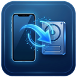
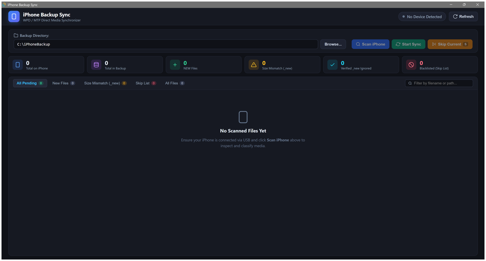

<div align="center">



# iPhone Backup Sync

<p>
  <a href="https://github.com/mahdis24/iphone-backup-sync/releases/latest"></a>
  <a href="https://github.com/mahdis24/iphone-backup-sync/actions/workflows/ci.yml"></a>
  <a href="LICENSE"></a>
  <a href="https://microsoft.com/windows"></a>
  <br />
  <a href="https://tauri.app/"></a>
  <a href="https://www.rust-lang.org/"></a>
  <a href="https://vuejs.org/"></a>
  <a href="https://www.typescriptlang.org/"></a>
</p>

<p>
  <a href="https://www.producthunt.com/products/iphone-backup-sync?embed=true&amp;utm_source=badge-featured&amp;utm_medium=badge&amp;utm_campaign=badge-iphone-backup-sync" target="_blank" rel="noopener noreferrer"></a>
  <a href="https://trendshift.io/repositories/355344?utm_source=trendshift-badge&amp;utm_medium=badge&amp;utm_campaign=badge-trendshift-355344" target="_blank" rel="noopener noreferrer"></a>
</p>

### [⬇️ Download Latest Release (.exe)](https://github.com/mahdis24/iphone-backup-sync/releases/latest)

</div>

---

**iPhone Backup Sync** is a high-performance desktop application designed for fast, incremental local backup of iPhone DCIM photos and videos to Windows drives using Rust, Tauri, and `libimobiledevice` / Windows Portable Devices (WPD) protocols. Communicating directly with low-level device streaming interfaces, it prevents MTP transfer freezes, handles size conflicts without overwriting, and operates completely offline with zero cloud subscriptions.

---

## Comparison

| Feature / Capability                      | `iphone-backup-sync`                                                                                              | Windows File Explorer                                                                                     | iTunes / iCloud for Windows                                                                         |
| :---------------------------------------- | :---------------------------------------------------------------------------------------------------------------- | :-------------------------------------------------------------------------------------------------------- | :-------------------------------------------------------------------------------------------------- |
| **Incremental Sync**                      | **Yes** - indexes destination and copies only new or modified assets                                              | **No** - manual drag-and-drop; re-evaluates all files on every copy                                       | **Partial** - iTunes creates opaque device image; iCloud syncs through cloud                        |
| **Conflict & Duplicate Handling**         | **Non-destructive** - preserves originals, saves size mismatches as `<stem>_new.<ext>`, skips verified duplicates | **Destructive / Guesswork** - prompts to overwrite or skip without byte verification                      | **Opaque** - overwrites or replaces local files based on cloud cache state                          |
| **Scan Transparency**                     | **High** - multi-stage real-time progress with live counters for enumeration, backup indexing, and diffing        | **None** - opaque green loading bar without file counts or phase indicators                               | **None** - indeterminate spinning indicator                                                         |
| **Connection Stability & Crash Recovery** | **High** - atomic `.part` streaming, strict byte verification, and safe lockfile crash recovery                   | **Poor** - freezes with _"Catastrophic failure"_ or _"Device unreachable"_, leaving corrupt partial files | **Moderate / Rigid** - fails entire backup batch if a single connection timeout occurs              |
| **Cancellation & Stop**                   | **Safe & Instant** - dedicated Cancel Scan and Stop Sync buttons; automatically removes partial `.part` fragments | **Unresponsive** - canceling often hangs Explorer or leaves corrupt truncated files                       | **Slow / Incomplete** - canceling may invalidate local cache or require full restart                |
| **Granular File Actions**                 | **Yes** - right-click table rows to sync single files or toggle skip status; interactive metric filters           | **Limited** - all-or-nothing Explorer batch queues                                                        | **None** - monolithic sync without individual item controls                                         |
| **Cloud & Subscription Requirements**     | **Zero** - 100% offline, local direct USB transfer                                                                | **Zero** - offline USB, but hampered by MTP driver stalls                                                 | **Required for Full Library** - requires Apple ID and paid iCloud storage plans for large libraries |
| **Stuck File Handling**                   | **Instant skip** with <kbd>S</kbd> key; blacklists failing asset without halting batch                            | **Unresponsive** - hangs entire Explorer window; requires killing task or unplugging device               | **Fails entire process** - aborts backup on unreadable files                                        |
| **Path & Unicode Integrity**              | **Sanitized** - strips invisible iOS Unicode direction markers (`\u{200E}`, `\u{200F}`, etc.)                     | **Unsanitized** - fails path checks or creates phantom folders on NTFS drives                             | **Abstracted** - stored inside proprietary iOS backup database structure                            |

---

## Preview



---

## Installation & Windows SmartScreen

Download the latest `.exe` installer or standalone executable from the [GitHub Releases](https://github.com/mahdis24/iphone-backup-sync/releases/latest) page.

### Handling the "Unknown Publisher" Notice

When running the installer for the first time, Windows Defender SmartScreen may display a warning dialog stating _"Windows protected your PC"_ or _"Unknown Publisher"_.

> **Why does this happen?**  
> `iphone-backup-sync` is a free, community-driven open-source project. Code-signing certificates that suppress this prompt (Extended Validation / EV certificates) require costly annual subscriptions from commercial certificate authorities.

To run the application:

1. Click **More info** on the SmartScreen dialog.
2. Click **Run anyway**.

**Security & Open-Source Assurance:**

- The complete source code is publicly accessible and auditable in this repository.
- Binaries are built transparently in isolated virtual machines using GitHub Actions (`.github/workflows/release.yml`).
- No telemetry, analytics, or external network requests are executed at any time.
- You can inspect the automated build logs or build the binary locally from source.

---

## Recommended iPhone Setting

To avoid mid-transfer iOS transcoding crashes over USB, configure your device:

1. Open **Settings** on your iPhone.
2. Navigate to **Photos**.
3. Scroll to the bottom under **Transfer to Mac or PC** and select **Keep Originals**.

Selecting _Keep Originals_ prevents iOS from attempting on-the-fly HEIC/JPEG or ProRes/H.264 transcoding, which is the primary cause of MTP stream timeouts and device resets.

---

## Core Features

- **Direct WPD & MTP Streaming:** Directly interfaces with the Windows Portable Devices COM subsystem (`IPortableDeviceManager`, `IPortableDevice`, `IPortableDeviceContent`, `IStream`) and compatible with `ifuse` / `libimobiledevice` architectures, eliminating Explorer shell crashes.
- **Session Lifecycle Management:** Scoped `WpdDeviceGuard` RAII design guarantees that `device.Close()` is always called upon scan completion or cancellation, preventing locked MTP sessions between operations.
- **Multi-Stage Real-Time Scan Progress:** Transparent progress visualization displaying exact stages (`connecting`, `enumerating`, `indexing`, `classifying`), live file counters, and percentage completion.
- **Scan & Sync Cancellation:** Instant, safe cancellation for active scans and ongoing batch transfers with automatic purging of temporary `.part` artifacts without blacklisting cancelled items.
- **Custom Context Menu & Granular Actions:** Right-click any table row to immediately sync that specific file or toggle its inclusion in the persistent skip list.
- **Interactive Metric Filters:** Summary cards (Total on iPhone, Total in Backup, NEW Files, Size Mismatch, Verified Ignored, Blacklisted) act as live filters for the table, with a dedicated "Failed" filter for unreadable items.
- **Resilient Sync Error Recovery:** Files encountering MTP read faults (such as `0x8007001E`) are tagged with `ERROR` status, preserving full details without stalling the queue or freezing the UI.
- **Recursive DCIM Scanning:** Recursively traverses the iPhone storage root, automatically discovering all media subdirectories (`DCIM/*APPLE`).
- **Byte-Exact Diffing & Classification:** Scans destination folders via indexed hash maps, classifying assets into:
  - `NEW`: Asset does not exist in target backup directory.
  - `MISMATCH`: Asset exists with a different file size.
  - `VERIFIED_IGNORED`: Asset exists with exact byte match, or an exact-sized `_new` variant is already present.
  - `SKIPPED`: Asset is listed in the persistent skip list.
  - `ERROR`: Asset encountered a device read or transfer fault.
- **Non-Destructive Conflict Resolution:** Size-mismatched files are saved with a `_new` suffix (e.g., `IMG_1234_new.HEIC`). If an identical-sized `_new` file already exists, it is marked as backed up and skipped automatically.
- **Resilient Chunked Streaming:** Media streams in 64 KB - 256 KB buffers directly into temporary `.part` files, validating exact byte counts and atomically renaming to final destination only after complete transfer.
- **Crash Recovery & Lockfile Tracking:** Employs a `current_copying.tmp` lockfile. If an MTP disconnection or system shutdown occurs mid-copy, incomplete `.part` fragments are automatically cleaned up on next startup without blacklisting the interrupted asset.
- **Dynamic Path Resolution & Session Resilience:** Automatically resolves WPD object IDs using hierarchical path lookup and reconnects if an MTP connection resets (such as error `0x8007001F`).
- **Locale-Agnostic Storage Traversal:** Detects device media containers regardless of Windows display language (German, Spanish, French, etc.) without relying on hardcoded English folder labels.
- **Case-Insensitive Windows Path Diffing:** Ensures assets with differing file extension or folder casing (such as `.heic` vs `.HEIC` or `100apple` vs `100APPLE`) correctly match existing backups rather than creating duplicate downloads.
- **Instant Skip Shortcut (<kbd>S</kbd>):** Press <kbd>S</kbd> or click **Skip Current** to immediately drop an in-flight file, delete its partial fragment, add it to `skip_list.json`, and proceed with remaining queue.
- **Skip List Management:** Full UI interface to inspect blacklisted files, remove specific entries, or clear the entire skip list.
- **Unicode Path Sanitization:** Strips invisible Unicode direction control markers (`\u{200E}`, `\u{200F}`, `\u{202A}`..=`\u{202E}`) from iOS metadata to ensure valid NTFS paths.
- **Real-Time Transfer Metrics:** Displays current file progress, overall batch percentage, streaming throughput (MB/s), and real-time status banners.
- **Offline & Private:** Operates strictly over local USB with zero telemetry or network calls.

---

## Architecture

```
iphone-backup-sync/
├── src/                          # Vue 3 + TypeScript Frontend
│   ├── App.vue                   # Dashboard, real-time monitors, and file tables
│   ├── types.ts                  # Serde-synchronized TypeScript data contracts
│   ├── style.css                 # Dark-mode styling, responsive metrics, custom scrollbars
│   └── main.ts                   # Application bootstrap
├── src-tauri/                    # Rust Backend (Tauri v2)
│   ├── src/
│   │   ├── wpd.rs                # Windows Portable Devices COM wrappers & chunked streaming
│   │   ├── sync.rs               # Diffing engine, crash recovery, and skip-list manager
│   │   ├── lib.rs                # Tauri command dispatch and IPC event emitters
│   │   └── main.rs               # Executable entrypoint
│   ├── Cargo.toml                # Rust dependencies (windows, tokio, walkdir, serde)
│   └── tauri.conf.json           # Tauri v2 application configuration & bundle settings
└── .github/workflows/            # GitHub Actions CI/CD pipelines
    ├── ci.yml                    # Automated formatting, linting, and build verification
    └── release.yml               # Automated release packaging via tauri-action
```

---

## Building from Source

### Prerequisites

- **Operating System:** Windows 10 or 11 (64-bit).
- **Rust Toolchain:** Stable `x86_64-pc-windows-msvc` toolchain ([rustup.rs](https://rustup.rs/)).
- **Node.js runtime or Bun:** [Bun](https://bun.sh/) (v1.0+) or [Node.js](https://nodejs.org/) (v18+).
- **C++ Build Tools:** [Visual Studio C++ Build Tools](https://visualstudio.microsoft.com/visual-cpp-build-tools/) with Windows SDK.

### 1. Clone the Repository

```bash
git clone https://github.com/mahdis24/iphone-backup-sync.git
cd iphone-backup-sync
```

### 2. Install Frontend Dependencies

Using Bun (recommended):

```bash
bun install
```

Using npm:

```bash
npm install
```

### 3. Run in Development Mode

```bash
bun run tauri dev
# or: npm run tauri dev
```

### 4. Run Quality Checks & Linters

```bash
# Frontend type check & build
bun run build
# or: npm run build

# Rust formatting check
cargo fmt --manifest-path src-tauri/Cargo.toml -- --check

# Rust Clippy linter
cargo clippy --manifest-path src-tauri/Cargo.toml -- -D warnings
```

### 5. Build Standalone Installer & Binary

```bash
bun run tauri build
# or: npm run tauri build
```

Compiled binaries and NSIS installer (`.exe`) are output to:
`src-tauri/target/release/bundle/nsis/`

---

## Usage Workflow

1. Connect your iPhone to your Windows PC with a high-quality USB cable.
2. Unlock your iPhone and tap **Trust This Computer** if prompted.
3. Launch **iPhone Backup Sync**. The detected device will appear in the top-right status badge.
4. Click **Browse...** to select your target backup directory on any internal, external, or networked drive.
5. Click **Scan iPhone**. Monitor live progress across MTP connection, device enumeration, backup indexing, and diff comparison. Click **Cancel Scan** at any time to abort.
6. Review the classified file table or click summary metric cards to filter by file category (`NEW`, `Size Mismatch`, `Verified Ignored`, `Failed`, etc.).
7. (Optional) Right-click any file row to **Sync this file** individually or toggle **Skip file**.
8. Click **Start Sync** to initiate incremental chunked copying.
9. Use <kbd>S</kbd> or **Skip Current** at any point during active transfer to skip an unresponsive asset, or click **Stop Sync** to cleanly abort the entire operation without leaving incomplete files.

---

## Shortcuts & Controls

| Control / Action         | Trigger                                | Purpose                                                                          |
| :----------------------- | :------------------------------------- | :------------------------------------------------------------------------------- |
| **Row Context Menu**     | Right-click table row                  | Open actions menu ("Sync this file", "Skip file")                                |
| **Close Context Menu**   | <kbd>Esc</kbd> / Click outside         | Dismiss the active context menu                                                  |
| **Skip Current File**    | <kbd>S</kbd> / **Skip Current** button | Abort in-flight file, delete `.part` fragment, and add to skip list              |
| **Stop Synchronization** | **Stop Sync** button                   | Terminate batch transfer immediately and safely purge partial files              |
| **Cancel Scan**          | **Cancel Scan** button                 | Abort ongoing device scan and indexing without freezing                          |
| **Category Filters**     | Click metric cards / tabs              | Filter table by status (`All Pending`, `New`, `Mismatch`, `Failed`, `Skip List`) |

---

## Contributing

Contributions and issue reports are welcome. Please consult [CONTRIBUTING.md](CONTRIBUTING.md) and [CODE_OF_CONDUCT.md](CODE_OF_CONDUCT.md) before opening a pull request.

---

## License & Security

- **License:** Distributed under the [MIT License](LICENSE).
- **Security:** Review [SECURITY.md](SECURITY.md) for vulnerability disclosure procedures.
- **Changelog:** Review [CHANGELOG.md](CHANGELOG.md) for version release history.
- **Author:** Created by [Mahdi Salek](https://mahdis24.tech) ([@mahdis24](https://github.com/mahdis24)).

---

<p>
 <a href="https://uno.directory" target="_blank" rel="noopener">
  
</a>
 <a href="https://aitop10.tools/" target="_blank">AiTop10 Tools</a>
  <a href="https://vibecodinglist.com/projects/iphone-backup-sync?utm_source=vcl_badge&utm_medium=builder_site&utm_campaign=listed_badge&utm_content=iphone-backup-sync" target="_blank" rel="noopener">
  
</a>
  <a href="https://lift-off.sh/p/iphone-backup-sync" target="_blank" title="LiftOff launch badge">
  
</a>
  <a href="https://newtool.site/item/iphone-backup-sync?utm_source=github.com" target="_blank" rel="noopener">
  
</a>
</p>
